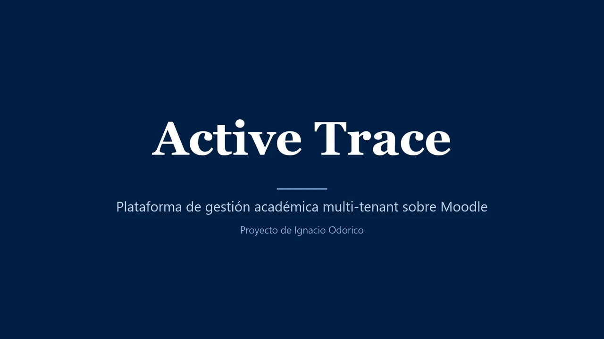
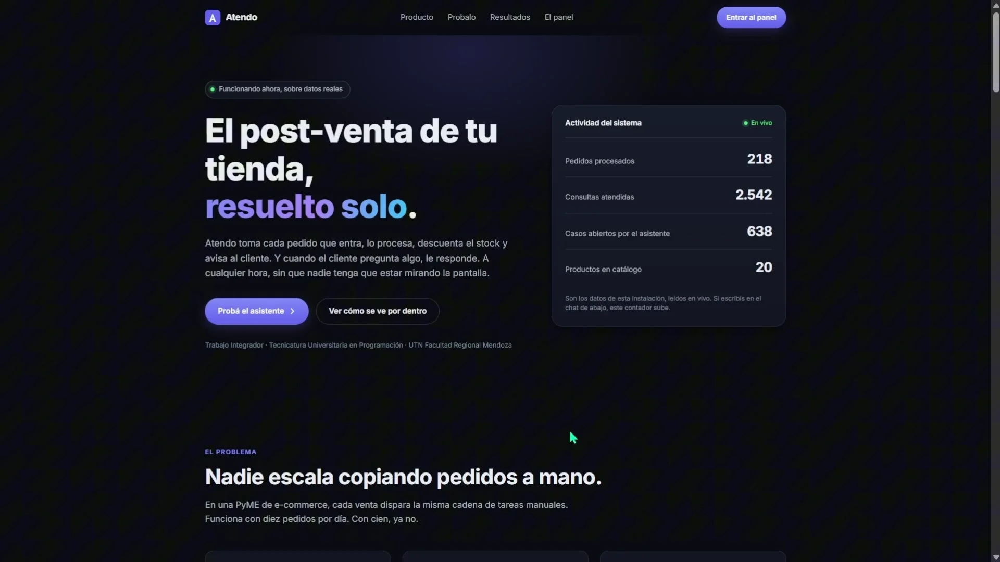
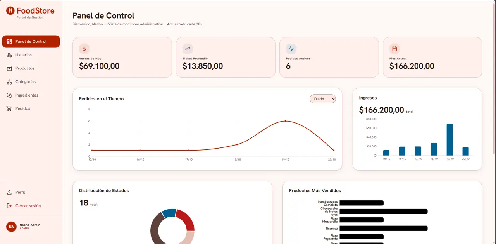
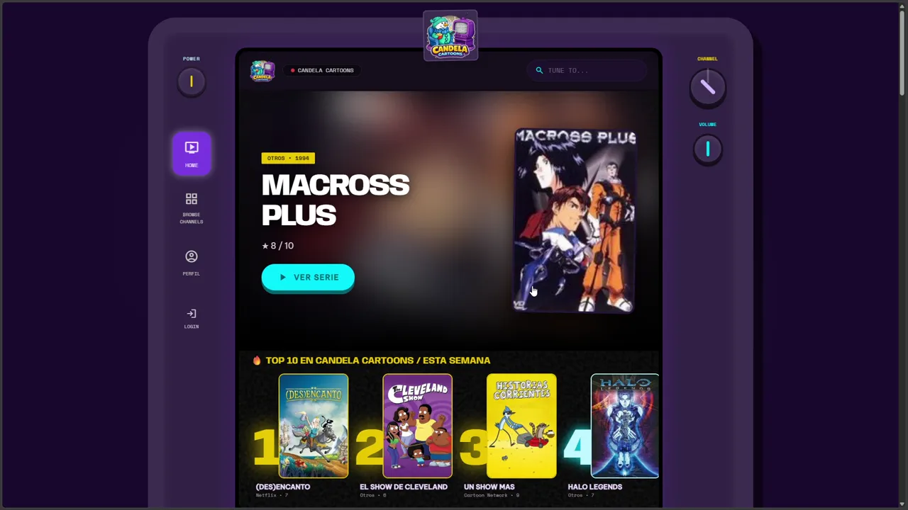
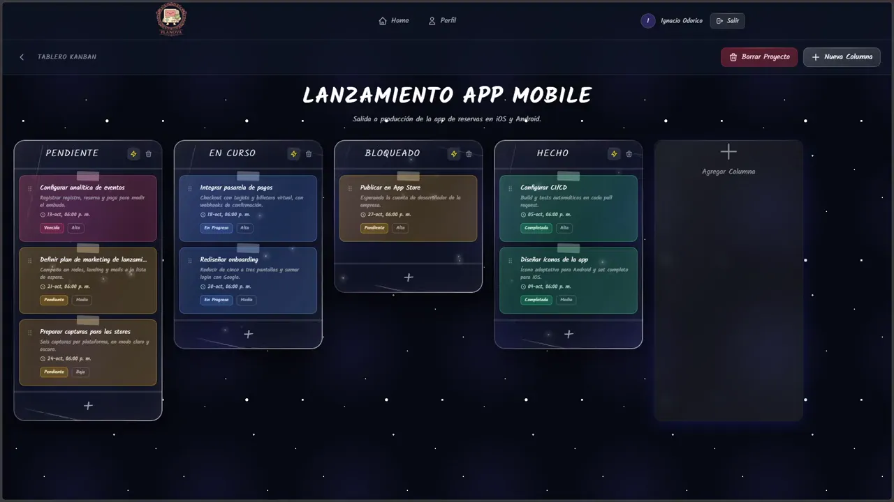

<picture>
  <source media="(prefers-color-scheme: dark)" srcset="./assets/hero-dark.svg">
  <source media="(prefers-color-scheme: light)" srcset="./assets/hero-light.svg">
  
</picture>

 

## 👋 Sobre mí

Soy **programador egresado de la UTN** (Técnico Universitario en Programación) y **desarrollador Full Stack**. Construyo productos completos de punta a punta: base de datos, API REST, interfaz, seguridad, Docker y CI, con **más de 3.000 tests automatizados** entre mis proyectos.

Mi diferencial es la IA en dos frentes: la **integro en los productos** (asistentes que responden consultas por WhatsApp, Telegram y correo, análisis y redacción con LLMs, flujos de n8n que trabajan solos) y la **uso como un equipo de desarrollo**, con metodología.

Hoy trabajo como **desarrollador freelance**: diseño apps de pedidos online a medida para PyMEs gastronómicas y consigo mis propias oportunidades con Anzuelo, el CRM con IA que desarrollé. Busco sumarme a un equipo donde aportar desde el primer día, en el stack que haga falta.

## 🚀 Proyectos destacados

<table>
  <tr>
    <td width="50%" valign="top">
      
      <h3>🎣 Anzuelo · CRM de prospección con IA</h3>
      
Lo uso todos los días para conseguir clientes: <b>8 workflows de n8n</b> encuentran negocios, la IA los analiza y redacta el primer mensaje, con envíos controlados y aprobación humana. FastAPI con <b>90 endpoints</b>, PWA en React + TypeScript y <b>más de 1.800 tests</b>.

      
<code>n8n</code> <code>OpenAI</code> <code>FastAPI</code> <code>PostgreSQL</code> <code>React</code> <code>Docker</code>

      
<a href="https://ignacioodorico.github.io/portafolio-ignacio-odorico/pag2-portafollio/index.html#proyecto-anzuelo">▶ Video demo</a> · 🔒 Repo privado

    </td>
    <td width="50%" valign="top">
      
      <h3>🎓 Active Trace · Gestión académica multi-tenant</h3>
      
Se monta sobre Moodle: detecta alumnos atrasados, gestiona comunicaciones masivas con cola y worker, y tiene <b>7 roles</b> con datos aislados por institución. JWT rotativo, 2FA, <b>cifrado AES-256</b>, auditoría y <b>más de 1.300 tests</b>.

      
<code>FastAPI</code> <code>SQLAlchemy</code> <code>PostgreSQL</code> <code>React</code> <code>TypeScript</code> <code>OpenTelemetry</code>

      
<a href="https://ignacioodorico.github.io/portafolio-ignacio-odorico/pag2-portafollio/index.html#proyecto-active-trace">▶ Video demo</a> · <a href="https://github.com/IgnacioOdorico/active-trace">📂 Código</a>

    </td>
  </tr>
  <tr>
    <td width="50%" valign="top">
      
      <h3>🤖 Atendo · Atención al cliente con IA</h3>
      
Mi trabajo integrador de la UTN: un asistente de IA que atiende por <b>WhatsApp, Telegram y correo</b>, clasifica la consulta y deriva los reclamos, y automatiza el post-venta de un e-commerce. Medido en laboratorio: <b>92,7 % de exactitud</b> al clasificar.

      
<code>n8n</code> <code>GPT-4o-mini</code> <code>FastAPI</code> <code>PostgreSQL</code> <code>React</code> <code>Grafana</code>

      
<a href="https://ignacioodorico.github.io/portafolio-ignacio-odorico/pag2-portafollio/index.html#proyecto-atendo">▶ Videos demo</a> · <a href="https://github.com/IgnacioOdorico/Automatizacion-de-Atencion-al-Cliente-en-E-commerce-e-Inteligencia-Artificial">📂 Código</a>

    </td>
    <td width="50%" valign="top">
      
      <h3>🍔 FoodStore · Pedidos para locales de comida</h3>
      
Tienda con pago por <b>MercadoPago</b> (webhook firmado con HMAC) y panel con pedidos en <b>tiempo real por WebSockets</b>, máquina de estados con auditoría, stock y métricas. 4 roles, JWT rotativo y casi 100 tests con Pytest.

      
<code>FastAPI</code> <code>PostgreSQL</code> <code>React</code> <code>TypeScript</code> <code>WebSockets</code> <code>Docker</code>

      
<a href="https://ignacioodorico.github.io/portafolio-ignacio-odorico/pag2-portafollio/index.html#proyecto-foodstore">▶ Video demo</a> · <a href="https://github.com/IgnacioOdorico/FoodStore-completo">📂 Código</a>

    </td>
  </tr>
  <tr>
    <td width="50%" valign="top">
      
      <h3>📺 Candela Cartoons · Streaming retro</h3>
      
Un solo catálogo y un solo reproductor para dibujos clásicos alojados en servidores de terceros: <b>17 resolvers</b> hechos con <b>ingeniería inversa</b> de cada reproductor web y un <b>proxy HLS propio</b>. Proyecto educativo: no aloja video.

      
<code>React</code> <code>Node.js</code> <code>Express</code> <code>SQLite</code> <code>Puppeteer</code> <code>HLS</code>

      
<a href="https://ignacioodorico.github.io/portafolio-ignacio-odorico/pag2-portafollio/index.html#proyecto-candela">▶ Video demo</a> · 🔒 Repo privado

    </td>
    <td width="50%" valign="top">
      
      <h3>🪐 Planova · Gestor de tareas Kanban</h3>
      
API REST en <b>Java y Spring Boot</b> con JWT y validación de propiedad en cada petición, frontend en React + TypeScript con drag &amp; drop, prioridades y vencimientos. Se levanta completo con un solo comando de Docker.

      
<code>Java</code> <code>Spring Boot</code> <code>React</code> <code>TypeScript</code> <code>MySQL</code> <code>Docker</code>

      
<a href="https://ignacioodorico.github.io/portafolio-ignacio-odorico/pag2-portafollio/index.html#proyecto-planova">▶ Video demo</a> · <a href="https://github.com/IgnacioOdorico/PLANOVA">📂 Código</a>

    </td>
  </tr>
</table>

## 🧠 Cómo trabajo con IA

- **Spec-Driven Development (SDD) con OpenSpec**: propuesta, especificaciones, diseño y tareas antes de escribir código, para que la IA construya sobre requisitos claros.
- **Organic Driven Development (ODD)**: plan de tareas por feature, commits por unidad de trabajo y PRs encadenados (*stacked PRs*) chicos y fáciles de revisar.
- **Agentes en Claude Code**: subagentes para explorar, implementar y verificar, cuidando la **ventana de contexto** en tareas largas.
- **Memoria persistente con Engram** entre sesiones y servidores **MCP** (Context7, CodeGraph).
- **Calidad**: TDD estricto, revisión adversarial con revisores independientes y verificación con evidencia antes de dar algo por terminado.

  
  
  
  
  
  

## 🛠️ Stack

<picture>
  <source media="(prefers-color-scheme: dark)" srcset="./assets/stack/stack-dark.svg">
  
</picture>

## 📊 Actividad

  <picture>
    <source media="(prefers-color-scheme: dark)" srcset="./assets/langs-dark.svg">
    
  </picture>
    
  <picture>
    <source media="(prefers-color-scheme: dark)" srcset="https://raw.githubusercontent.com/IgnacioOdorico/IgnacioOdorico/output/github-snake-dark.svg">
    
  </picture>

## 🎓 Formación

**Técnico Universitario en Programación** — Universidad Tecnológica Nacional (UTN), Mendoza · egresado 2026 
Trabajo integrador: **Atendo**, automatización de la atención al cliente en e-commerce con IA.

## 📫 Contacto

Los gráficos de este perfil se generan solos con GitHub Actions en este mismo repo, sin depender de servicios externos.
